# Omni-Grid Civic Issue Triage

Omni-Grid is a modular civic-complaint triage toolkit for compatible AI agents
and engineers. It validates complaint data, groups nearby reports into
hotspots, extracts metadata from supporting media, checks closure evidence,
and produces a structured report with traceable claims.

The project explores **Track 2: Best Open-Source AI Project**, with a focus on
**O3: Trustworthy and Verifiable AI**. It is an open-source development
project, not a deployed municipal service: no official adoption, real-world
validation, or production readiness is claimed.

## Contents

- [Why Omni-Grid](#why-omni-grid)
- [Features and status](#features-and-status)
- [Architecture](#architecture)
- [Technology and design](#technology-and-design)
- [Repository map](#repository-map)
- [Install and configure](#install-and-configure)
- [Quickstart](#quickstart)
- [Hosted dashboard and deployment](#hosted-dashboard-and-deployment)
- [Use with an AI agent and an engineer](#use-with-an-ai-agent-and-an-engineer)
- [Trust, verification, and limitations](#trust-verification-and-limitations)
- [Synthetic evaluation](#synthetic-evaluation)
- [Data, privacy, and responsible use](#data-privacy-and-responsible-use)
- [Current constraints and roadmap](#current-constraints-and-roadmap)
- [Open source and community](#open-source-and-community)
- [Documentation and references](#documentation-and-references)

## Why Omni-Grid

Municipal operations teams can receive many complaints about the same
underlying problem, including reports clustered around a shared location.
Reviewers also need to assess whether closure evidence is relevant and whether
the available facts support a summary. Omni-Grid provides repeatable
pre-processing and evidence checks to help civic engineers, municipal
operations teams, auditors, and AI-agent developers inspect that work.

The pipeline automates schema validation, media metadata extraction, spatial
clustering, deterministic closure checks, and structured report generation.
Optional model assistance can compare images, estimate visible damage, and
draft claims from supplied facts. Engineers still need to examine source
evidence, resolve ambiguous or missing information, and make every operational
decision. A `suspect` result is a triage signal, not a finding of misconduct.

The open-source goal is to make the data contracts, checks, limitations, and
offline evaluation inspectable and reusable. The current sample is synthetic;
it does not demonstrate outcomes on real civic workflows.

## Features and status

| Area | Available in this repository |
| --- | --- |
| Complaint input | JSON complaint objects/arrays and GeoJSON `Feature` or `FeatureCollection` of `Point` features, validated with shared Pydantic schemas. |
| Evidence | Image EXIF GPS/time extraction, perceptual image hashing, supported video keyframe extraction, media path confinement, and skipped-media diagnostics. |
| Hotspots | Deterministic DBSCAN clustering with haversine distance, configurable radius/minimum size, and explainable severity scoring. |
| Closure checks | Deterministic GPS geofence, duplicate-evidence, timestamp, and category-consistency checks. Missing or ambiguous evidence can be inconclusive. |
| Optional inference | OpenAI-compatible text and vision requests for summaries, damage scoring, and comparable before/after images. Mock mode is offline and uses deterministic templates instead. |
| Reports | A validated `Report` containing complaints, hotspots, verdicts, claims, and pipeline statistics. Summary claim citations and numeric tokens are checked against known IDs and supplied facts. |
| Entry points | Python library, `omnigrid` CLI, portable Agent Skill, FastAPI service, same-origin dashboard, and offline demo-report exporter; pipeline routes use the canonical pipeline. |
| Browser demo | Public, no-login Leaflet dashboard calls the API for a synthetic demo or GeoJSON upload. Offline exported JSON remains a separate artifact and is never a live-request fallback. |
| Evaluation | Offline harness against checked-in synthetic complaints and planted ground truth. The published run is mock/deterministic; it is not a real-world accuracy study. |

The `evidence`, `verify`, and `summarize` CLI subcommands validate existing
schema-shaped JSON; they do **not** extract evidence, run verification, or
generate summaries. Use `triage` or the Python pipeline for those operations.

## Architecture

The normal end-to-end route runs through `run_pipeline`. Optional provider
work is shown separately because mock mode, unavailable media, or disabled
vision can skip it. The evaluation harness is a separate offline path that
compares pipeline output with synthetic ground truth.

```mermaid
flowchart LR
  Input["Complaint JSON / GeoJSON + local media"] --> Ingest["Ingest and validate"]
  Ingest --> Complaints["Pydantic Complaint records"]
  Complaints --> Evidence["Extract image/video metadata, EXIF, pHash, keyframes"]
  Evidence --> DamageGate{"Live damage scoring eligible?"}
  DamageGate -->|Yes| DamageModel["Optional vision damage scoring"]
  DamageGate -->|Mock or unavailable| NoDamage["No model damage score"]
  Complaints --> Cluster["DBSCAN / haversine clustering and severity"]
  DamageModel --> Cluster
  NoDamage --> Cluster
  Evidence --> Deterministic["Deterministic closure checks"]
  Complaints --> Deterministic
  Deterministic --> VisionGate{"Live vision enabled and comparable images?"}
  VisionGate -->|Yes| Vision["Optional before/after vision check"]
  VisionGate -->|No or skipped| SkipVision["Skip optional vision"]
  Deterministic --> Verdicts["Combine checks; deterministic failures take precedence"]
  Vision --> Verdicts
  SkipVision --> Verdicts

  Cluster --> Summary["Summary generation from computed facts"]
  Verdicts --> Summary
  Summary --> TextGate{"Text model enabled?"}
  TextGate -->|Live| TextModel["Optional OpenAI-compatible text model"]
  TextGate -->|Mock mode| Template["Deterministic template claims"]
  TextModel --> ClaimCheck["Validate claim schema, citation IDs, and numbers"]
  TextModel -->|Provider or validation fallback| Template
  Template --> ClaimCheck
  ClaimCheck --> Report["Validate structured Report"]

  CLI["CLI / Python API"] --> Ingest
  Skill["Agent Skills contract and wrappers"] --> CLI
  API["FastAPI /demo and /triage"] --> Ingest
  Report --> Export["Demo exporter (mock by default)"]
  Export --> OfflineWeb["Offline web/demo report and media"]
  Dashboard["Same-origin Leaflet dashboard"] --> API
  Report --> Engineer["Engineer reviews evidence and checks"]
  OfflineWeb --> Engineer

  subgraph Eval["Separate offline evaluation path"]
    Synthetic["Synthetic complaints + media"] --> SharedPipeline["Canonical pipeline in mock mode"]
    SharedPipeline --> Harness["eval.run_eval"]
    GroundTruth["Planted synthetic ground truth"] --> Harness
    Harness --> Metrics["Recall, purity, verification, citations, timings"]
  end
```



The API upload accepts complaint GeoJSON only; it does not upload media files.
Its request-scoped media directory is empty, so media references in an upload
are unavailable to that request's pipeline. See [API details](docs/api.md) for
the exact contract and limits.

## Technology and design

- **Python 3.11+** with setuptools packaging and an installable `omnigrid`
  console command.
- **Pydantic v2** schemas define the shared complaint, evidence, verdict,
  hotspot, claim, and report contracts.
- **NumPy and scikit-learn** provide DBSCAN clustering; the implementation
  uses geographic haversine distance and explicit meter-based options.
- **Pillow, ImageHash, piexif, and OpenCV** support image metadata/hash work
  and video keyframe extraction.
- **OpenAI Python SDK** supplies a client for configured OpenAI-compatible
  text and vision endpoints. **python-dotenv** loads supported settings from
  `.env`.
- **FastAPI, Starlette, python-multipart, and Uvicorn** are optional API
  dependencies.
- **pytest, Ruff, httpx, and PyYAML** are development/test dependencies.
- The browser demo uses HTML, CSS, JavaScript, and Leaflet loaded from a CDN;
  the map uses OpenStreetMap tiles.

Important design choices:

1. Deterministic evidence checks are kept distinct from model opinions.
   A failed deterministic check remains suspect; vision inference cannot
   override it.
2. Pydantic validates structured inputs and report outputs at boundaries.
3. Claim citation identifiers and numeric tokens are checked before a report
   is returned. These checks improve traceability but do not prove a claim is
   semantically supported by its cited evidence.
4. Mock mode provides an offline route without provider calls. Its
   deterministic template claims are not model-generated.
5. CLI triage, the optional API, and demo export reuse the canonical pipeline.
   Validator-only CLI subcommands intentionally do not impersonate pipeline
   stages.
6. The synthetic generator fixes its random seed and plants known cases for
   repeatable development tests; this is not a representative civic dataset.

## Repository map

```text
.
├── api/                    Optional local FastAPI service
├── core/omnigrid/          Schemas, ingestion, evidence, clustering,
│                           verification, LLM client, summaries, pipeline, CLI
├── data/
│   ├── samples/            Synthetic contract examples
│   └── synthetic/          Synthetic GeoJSON, planted ground truth, generated media
├── docs/                   Pipeline, API, model, skill-test, and audit notes
├── eval/                   Offline evaluation harness and checked-in report
├── references/             Severity scoring reference
├── scripts/                Synthetic data generation and demo export
├── skill/omni-grid/        Agent Skill instructions, references, and CLI wrappers
├── tests/                  CLI, API, pipeline, model, data, and schema tests
├── web/                    Static report/map frontend and demo data
├── .github/workflows/      CI configuration
├── IMPLEMENTATION-PLAN.md  Original project implementation plan
├── Makefile                Common install, test, lint, demo, and eval targets
└── pyproject.toml          Package metadata and dependency extras
```

## Install and configure

The project baseline is Python 3.11. Run commands from the repository root.
The standard development and pipeline install includes the dependencies
needed for clustering, media tests, and CLI triage:

### Linux and macOS

```sh
python3.11 -m venv .venv
source .venv/bin/activate
python -m pip install --upgrade pip
python -m pip install -e ".[dev,pipeline]"
```

### Windows PowerShell

```powershell
py -3.11 -m venv .venv
.\.venv\Scripts\Activate.ps1
python -m pip install --upgrade pip
python -m pip install -e ".[dev,pipeline]"
```

PowerShell may block activation according to local execution policy; if so,
use the environment's approved activation method or call
`.venv\Scripts\python.exe` directly. Python does not include GNU Make on
Windows. Install GNU Make separately if you want the Makefile targets, or use
the direct Python commands below.

### Settings and secrets

Copy the example only if you want to customize local settings:

```sh
cp .env.example .env
```

```powershell
Copy-Item .env.example .env
```

`.env` is ignored by Git. Do not commit credentials, real complaint data, or
media. Endpoint, API key, model, and geospatial values are read from `.env`;
process environment values take precedence. `LLM_MOCK` and `LLM_TIMEOUT` are
read directly from the process environment in the current implementation,
not from `.env`.

| Variable | Default | Configuration source |
| --- | --- | --- |
| `LLM_BASE_URL` | `http://localhost:11434/v1` | `.env` or process environment |
| `LLM_API_KEY` | `ollama` (local placeholder) | `.env` or process environment |
| `LLM_TEXT_MODEL` | `qwen2.5:7b-instruct` | `.env` or process environment |
| `LLM_VISION_MODEL` | `qwen2.5vl:7b` | `.env` or process environment |
| `LLM_TIMEOUT` | 30 seconds | Process environment only |
| `LLM_MOCK` | `false` | Process environment only |
| `GEOFENCE_METERS` | 50 meters | `.env` or process environment |
| `CLUSTER_EPS_METERS` | 150 meters | `.env` or process environment |
| `CLUSTER_MIN_SAMPLES` | 3 complaints | `.env` or process environment |

By default, mock mode is off and the LLM client uses the configured
OpenAI-compatible endpoint (Ollama's local endpoint in the defaults). That
does **not** install or start Ollama. For an offline run, set `LLM_MOCK=true`
in the process environment before starting the command. In mock mode the
pipeline skips model inference and produces template claims.

#### Optional local Ollama inference

The checked-in defaults target Ollama's OpenAI-compatible endpoint. If you
want live local text and vision inference, install Ollama separately and pull
the configured models:

```sh
ollama pull qwen2.5:7b-instruct
ollama pull qwen2.5vl:7b
ollama serve
```

Keep Ollama running while issuing live requests. Model availability,
hardware requirements, and model-card terms are external to this repository.
No model weights are needed for mock-mode demos or tests.

#### Optional hosted OpenAI-compatible provider

Choose a provider and models that support the request features you use,
including image input for vision checks. The repository does not certify any
hosted provider. Set the actual endpoint and model identifiers documented by
your provider, and keep the API key in the ignored `.env` or process
environment:

```powershell
$env:LLM_BASE_URL = "https://<provider-base-url>/v1"
$env:LLM_API_KEY = "<provider-api-key>"
$env:LLM_TEXT_MODEL = "<provider-text-model-id>"
$env:LLM_VISION_MODEL = "<provider-vision-model-id>"
$env:LLM_MOCK = "false"
```

The key and selected task prompts/images are sent to that provider when live
inference is used. Review provider retention and privacy terms before sending
non-synthetic data.

## Quickstart

From the repository root, after installation:

### Run a complete offline triage

Linux/macOS:

```sh
LLM_MOCK=true python -m omnigrid.cli triage data/synthetic/complaints.geojson
```

Windows PowerShell:

```powershell
$env:LLM_MOCK = "true"
python -m omnigrid.cli triage data\synthetic\complaints.geojson
Remove-Item Env:LLM_MOCK
```

The CLI writes the schema-valid `Report` JSON to stdout; errors and diagnostic
messages go to stderr and unsuccessful input exits non-zero. The report has
`hotspots`, `verdicts`, `claims`, `stats`, and `complaints`. Use
`--help` for CLI options. The `--no-vision` option skips provider vision
checks while retaining deterministic verification. To write a persistent
sample report for the browser demo, use the exporter below; it writes
`web/demo/report.json` and referenced media.

The underlying library entry point is `omnigrid.pipeline.run_pipeline`.
`python -m omnigrid.cli triage INPUT` is the complete CLI route.

### Generate synthetic input

The checked-in sample is ready to use. If you intentionally need to regenerate
it, run this from the repository root:

```sh
python scripts/generate_synthetic.py
```

This script has no `--help` option. It overwrites
`data/synthetic/complaints.geojson` and `data/synthetic/ground_truth.json`,
and may recreate the generated media directory when media files are missing.
Back up local changes first. The committed data and media are synthetic and
are not needed to run the CLI.

### Export the browser demo

`make export-demo` runs the canonical pipeline in mock mode by default,
validates the report, and writes `web/demo/report.json` plus only referenced
media under `web/demo/media/`. It refreshes these generated repository files.
Without GNU Make, use:

```sh
python scripts/export_demo_report.py
```

The offline exported report can still be inspected separately by starting a
static server from the repository root:

```sh
python -m http.server 8000 --directory web
```

Then visit `http://localhost:8000`. The browser reads the exported JSON and
local media; this offline workflow is not connected to the API. Leaflet is loaded from
unpkg and map tiles come from OpenStreetMap, so those external services need
network access and receive normal browser requests for the assets/tiles they
serve. The hosted dashboard instead uses API results only and does not show a
stale report after a request failure.

### Local API and dashboard

Install API dependencies together with the required pipeline and development
extras:

```sh
python -m pip install -e ".[dev,pipeline,api]"
```

Start from the repository root; `LLM_MOCK=true` avoids provider calls:

```powershell
$env:LLM_MOCK = "true"
python -m uvicorn api.main:app --host 127.0.0.1 --port 8000
```

The service at `http://127.0.0.1:8000` serves the dashboard, `GET /health`,
`POST /demo` (checked-in synthetic input), and `POST /triage` (one
`multipart/form-data` file field named `file`). Public routes use the canonical
pipeline in deterministic mock mode. Upload a `.geojson` or `.json` GeoJSON
`Feature` or non-empty `FeatureCollection` with Point features and complaint
properties. Limits are 2 MiB per file, 1,000 features, two concurrent pipeline
requests, and 30 API requests per minute per client address. Uploads do not
include media files and cannot read server files. The unauthenticated service
is for a synthetic public demo, not municipal production use. Details and
status codes are in [docs/api.md](docs/api.md). Use the dashboard's **Run
Synthetic Demo** action or test an upload with:

```powershell
curl.exe -X POST http://127.0.0.1:8000/triage `
  -F "file=@data/synthetic/complaints.geojson;type=application/geo+json"
```

### Hosted dashboard and deployment

The dashboard is prepared for Render but has **not** been deployed. Review
[docs/deployment.md](docs/deployment.md) for the exact Blueprint settings,
environment-variable inventory, manual deployment walkthrough, cold-start
limitations, and judge demonstration steps. No provider key is required for
the public synthetic demo; no live municipal data or hosted deployment is
claimed.

### Tests, lint, and evaluation

With GNU Make installed:

```sh
make test
make lint
make eval
```

The exact direct Python equivalents (also useful on Windows without Make) are:

```sh
python -m pytest
python -m ruff check api core tests scripts eval
python -m eval.run_eval --output eval/results.md
```

The evaluation command overwrites the checked-in `eval/results.md`. To
preserve it while testing, pass another output path:

```sh
python -m eval.run_eval --output eval/local-results.md
```

The harness defaults to mock mode and does not need live credentials. Its
optional `--live` mode uses the configured provider and is not represented by
the checked-in report. See [Synthetic evaluation](#synthetic-evaluation) for
interpretation limits.

## Use with an AI agent and an engineer

The repository includes an Agent Skills-style instruction file at
[`skill/omni-grid/SKILL.md`](skill/omni-grid/SKILL.md). It describes what inputs
the skill accepts, how to invoke the supported CLI/wrappers, and how to
interpret their outputs:

1. A compatible agent must discover or be configured to load this skill. The
   repository does not install it into an agent automatically. After the
   implementation branch is merged, the Skills CLI can install this skill:

   ```powershell
   npx skills add https://github.com/ShreyaJ-27/omni-grid-civic-issue-triage/tree/main/skill/omni-grid --skill omni-grid
   ```

   The installer prompts for supported agent targets. The portable instructions
   also document the same-origin API and local CLI alternatives.
2. Invoke the agent's skill command (for the documented Claude Code setup,
   `/omni-grid`) and provide a real input path. Do not ask an agent to invent
   complaint records or missing evidence.
3. Supported inputs are a schema-valid complaint JSON object/array or a
   GeoJSON `Feature`/`FeatureCollection` with Point features and complaint
   properties. Media paths must resolve within the selected media root.
4. The skill directs the agent to reuse Omni-Grid's CLI, wrappers, shared
   Python library, or documented integration rather than reimplementing the
   schemas and checks. `triage` produces the complete structured report;
   validator-only CLI commands validate existing data only.
5. For a hosted dashboard, run the checked-in demo through `POST /demo` or
   upload supported GeoJSON through `POST /triage`; failures are shown rather
   than replaced with stale report JSON.
6. Engineers inspect report statistics, hotspots, verdict checks, claims,
   citations, and supporting evidence. They resolve inconclusive cases and
   decide whether to act. `web/demo/report.json` remains for the separate
   offline exporter workflow.

The skill instructions are reusable, but discovery and slash-command
behavior depend on the particular agent runtime. Python 3.11+, installed
project extras, file access, and the input schema are required. Live model
assistance additionally depends on the configured provider and compatible
models. The repository's manual live-agent discovery/trigger test is marked
pending in [docs/skill-smoke-test.md](docs/skill-smoke-test.md); automated
wrapper tests do not prove arbitrary agent compatibility.

## Trust, verification, and limitations

### Deterministic checks and model assistance

- Evidence extraction uses local media metadata such as EXIF GPS/timestamps
  and perceptual hashes; videos can be sampled into keyframes. Missing,
  unsafe, or unreadable media is skipped and counted rather than treated as
  proof.
- Closure checks can compare evidence GPS with complaint coordinates, flag
  duplicate perceptual hashes, check timestamp sanity, and compare
  category/defect signals. A failed deterministic check keeps the result
  suspect even if an optional vision assessment disagrees.
- Optional vision inference compares eligible before/after images; it is not
  used in mock mode and may be skipped when comparable images are unavailable.
  Model output is an estimate, not geographic proof or an engineering
  inspection.
- Optional damage-severity scoring is model-assisted and heuristic. It is
  not a civil-engineering assessment and missing scores are not evidence of
  no damage.
- Summary generation asks for claims based on precomputed facts. Citation IDs
  are checked against known report entities and numeric tokens against the
  supplied fact values. These validators do not establish that a cited
  source logically entails a sentence or that an image/model interpretation
  is correct.
- The final Pydantic `Report` is validated. `stats` indicates mock/live mode,
  skipped stages, fallbacks, evidence counts, verdicts, and claim counts.
  Live provider failures can produce fallback claims or inconclusive checks;
  they do not establish a successful model check.

LLM outputs do not substitute for source evidence, engineering judgment, or
human decisions. A `verified` label only describes the implemented checks
given the available inputs; it is not a guarantee that a repair is complete.
A `suspect` label is not proof of fraud, misconduct, or responsibility.

### Current limitations

- The geofence, duplicate, timestamp, and category checks are heuristics with
  known limits. For example, EXIF data can be absent, wrong, or manipulated;
  perceptual hashes can miss transformed/reused evidence; text/category
  checks can be incomplete.
- The current summary validation checks identifier membership and numeric
  token membership, not entailment, source quality, or factual completeness.
- The public demo API has no authentication. It is limited to synthetic,
  mock-mode demo use and is not hardened for production municipal workloads.
- Render deployment remains a manual step; no live service URL, provider
  integration, production data pipeline, or municipal workflow is claimed.
- Tests and synthetic benchmark results do not certify correctness on
  operational civic data.

## Synthetic evaluation

The supplied benchmark is generated locally by
[`scripts/generate_synthetic.py`](scripts/generate_synthetic.py). It contains
500 synthetic complaints (400 open, 100 closed), five planted geographic
hotspots, five planted suspicious closures, and generated media. See
[`data/README.md`](data/README.md) and
[`eval/results.md`](eval/results.md) for source details and the checked-in
report.

The report records a deterministic/mock execution with 15 referenced media
files (15 evidence items decoded). The values and denominators are:

| Metric | Reported result | What is counted |
| --- | --- | --- |
| Hotspot complaint recall | 100.0% (68/68) | Of the 68 complaint IDs planted in ground-truth hotspots, 68 appeared in detected hotspots. |
| Cluster purity | 72.1% (49/68) | For the 68 clustered complaint points, sum the most common complaint category in each detected cluster (49) and divide by all clustered points (68). |
| Duplicate-evidence recall | 100.0% (1/1) | The single planted duplicate pair was detected. The report does not provide a duplicate-detector precision/false-positive measure. |
| Suspicious-closure precision | 100.0% (5/5) | Five of five complaints flagged suspect were among the planted suspicious cases. |
| Suspicious-closure recall | 100.0% (5/5) | Five of five planted suspicious cases were flagged suspect. |
| Suspicious-closure F1 | 1.000 | Harmonic mean of the preceding precision and recall on this planted set. |
| Citation-ID validity | 100.0% (1/1) | The one cited identifier in the evaluated claims existed in the dataset/report. This is not a measure of semantic support. |
| Evaluation elapsed time | 0.823 s in the checked-in report | A single harness elapsed-time observation; see the timing caveat below. |

The verification report lists zero false positives and zero false negatives
for its five planted suspicious-closure cases. These are counts on a small,
deliberately planted synthetic set—not estimates of expected performance on
real reports. There is no published live model-assisted evaluation.

#### Reproducibility and timing caveats

The checked-in report metadata identifies commit `e66494b`, the base commit
before PR #39's merge (`b691986`) added the evaluation harness to `main`. The
report therefore does not identify the exact harness source revision used.
A fresh mock-mode run against the merged source during this documentation
audit reproduced the metric counts but measured 1.364 seconds. The harness uses
`time.perf_counter`, but its end-to-end timer starts before a separately
timed stage pass and stops after a second `run_pipeline` execution. Its
end-to-end figure therefore includes that extra work and is **not** a clean
single-pass pipeline-latency benchmark. The individual stage rows are
separately timed operations and are not components of the same end-to-end
run. Do not use either timing as a production performance claim.

The report's planted-GPS case descriptions say `5.0 km`, while the documented
default `GEOFENCE_METERS` is 50 meters. The effective runtime setting is not
recorded, so the threshold discrepancy is unresolved; the planted examples
are over 20 km away, so it does not change their suspect classification. The
report records input paths but no content hashes for the complaint or
ground-truth files, so it does not fully pin the exact dataset artifacts
used. No evaluation logic or result values were changed for this
documentation work.

Regenerate the report from the repository root with:

```sh
python -m eval.run_eval --output eval/results.md
```

This overwrites `eval/results.md`; use a separate `--output` path to keep the
checked-in report unchanged.

## Data, privacy, and responsible use

- The committed complaints, ground truth, and media are synthetic. The
  generated images are drawings, not real citizen photographs, and the
  generated records are not derived from municipal complaint logs. Their
  Bengaluru-like coordinates do not represent observed complaint frequency.
- Real civic data may expose precise locations, personal information, faces,
  license plates, home addresses, or sensitive details in text and media.
  Collect only what is necessary and obtain the appropriate authority and
  permissions. Remove or anonymize identifying content where appropriate.
- Protect local input media, generated reports, cache files, and logs with
  suitable access controls and retention/deletion practices. The repository
  ignores common local cache/output paths, but local generated files still
  need to be managed.
- Hosted model use sends relevant prompt content and selected images to the
  configured provider. Review provider handling and retention terms before
  sending real data. Mock mode makes no provider calls.
- The optional API accepts complaint JSON/GeoJSON, not uploaded media; it is
  unauthenticated and intended only for localhost/demo use. Do not expose it
  publicly.
- The browser demo requests Leaflet assets from unpkg and map tiles from
  OpenStreetMap. Those services receive ordinary browser requests, including
  tile-area requests for the displayed map.
- AI outputs can be incomplete, biased, or wrong. Have a qualified person
  review evidence before taking action against staff, contractors, or a
  public authority. A suspicious flag is not proof of misconduct.
- Demo and test outputs are not official civic records or evidence of an
  official municipal decision.

This section is project guidance, not legal advice. No compliance
certification or privacy/security audit is claimed.

## Current constraints and roadmap

**Implemented:** validated ingestion, evidence extraction, video keyframes,
hotspot clustering, deterministic closure checks, optional model-assisted
checks/summaries, structured reports, CLI, modular skill, optional local API,
static report viewer, and synthetic evaluation.

**Current constraints:** only the documented input schema and local workflow
are supported; provider/model behavior depends on external configuration;
the API is localhost/demo-only; live-agent behavior is not fully verified;
and synthetic results do not establish real-world performance. Timing
provenance concerns are documented above and have not been fixed in the
benchmark implementation.

**Tracked separately:** open repository issues include
[#21 — P11 and P12 deployment/demo presentation](https://github.com/ShreyaJ-27/omni-grid-civic-issue-triage/issues/21)
and [#40 — Before Deployment](https://github.com/ShreyaJ-27/omni-grid-civic-issue-triage/issues/40).
Their status and scope may change; neither is implemented by this
documentation update. See the [open issues](https://github.com/ShreyaJ-27/omni-grid-civic-issue-triage/issues)
for current work. Future deployment work must not be read as a claim that the
current API is production-ready.

## Open source and community

The project source and project-created synthetic materials are licensed under
the [MIT License](LICENSE). Third-party packages, external CDN assets, map
tiles, and optional model weights remain subject to their own licenses and
terms. A comprehensive third-party dependency/model license audit is not
claimed.

- Read the [Code of Conduct](CODE_OF_CONDUCT.md) and
  [Contributing Guide](CONTRIBUTING.md) before participating.
- Open a [GitHub issue](https://github.com/ShreyaJ-27/omni-grid-civic-issue-triage/issues)
  for bugs or proposals; search first and discuss larger changes before
  implementation.
- Use focused pull requests linked to their issues and run the documented
  tests/lint checks.
- Report suspected vulnerabilities using the process in
  [SECURITY.md](SECURITY.md); do not post sensitive details publicly.
- Hacktoberfest or other event participation does not guarantee acceptance
  or eligibility. Contributions should be useful, genuine, and reviewable;
  trivial or artificial pull requests are not welcome.

## Documentation and references

- [Implementation plan](IMPLEMENTATION-PLAN.md)
- [Pipeline behavior and report contract](docs/pipeline.md)
- [Optional API routes and upload limits](docs/api.md)
- [LLM and vision verification configuration](docs/llm-and-vision-verification.md)
- [Summary and damage-severity design notes](docs/summaries-and-damage-severity.md)
- [Skill contract](skill/omni-grid/SKILL.md)
- [Manual skill smoke test and verification status](docs/skill-smoke-test.md)
- [Render deployment and environment-variable handoff](docs/deployment.md)
- [Synthetic data notes](data/README.md)
- [Severity scoring reference](references/severity.md)
- [Evaluation methodology and current report](eval/results.md)
- [Tests and lint configuration](pyproject.toml), [Make targets](Makefile),
  and [CI workflow](.github/workflows/ci.yml)
- [Open project issues](https://github.com/ShreyaJ-27/omni-grid-civic-issue-triage/issues)
- [Contribution policies](#open-source-and-community)
